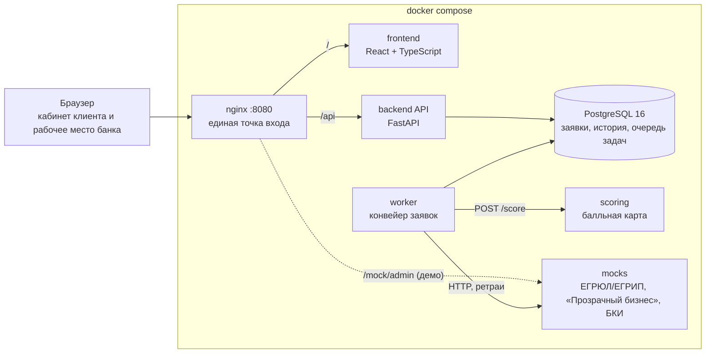
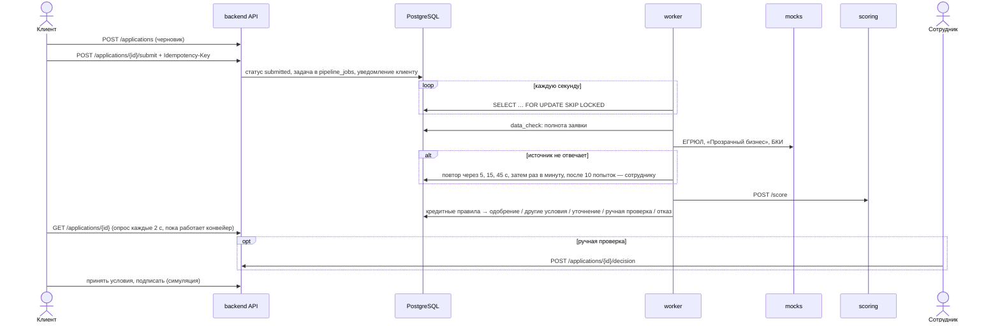

# Архитектура

## Компоненты

| Компонент | Технологии | Отвечает за |
| --- | --- | --- |
| `frontend` | React 19, TypeScript, Vite | Кабинет клиента: каталог и подбор продукта, заявка, статус, предложение, уточнения, подписание, уведомления. Рабочее место сотрудника: очереди, карточка заявки, решение. |
| `backend` | Python 3.12, FastAPI, SQLAlchemy 2, Alembic, PyJWT, bcrypt | API, авторизация и права, действия клиента и сотрудника, кредитные правила, уведомления. Единственная точка смены статуса — `lifecycle.transition`. |
| `worker` | тот же код, `python -m app.worker` | Автоматические этапы: проверка полноты, обогащение из внешних источников, скоринг, кредитное решение. Можно запускать несколько копий. |
| `scoring` | FastAPI, балльная карта в YAML | Оценка риска: PD, класс риска, факторы с баллами. Решение не принимает. |
| `mocks` | FastAPI, синтетические данные | Внешние источники с теми же контрактами, переключатель доступности для демо сбоев. |
| `db` | PostgreSQL 16 | Заявки, история переходов (аудит), проверки, оценки, решения, очередь задач, уведомления. |

## Как заявка проходит конвейер

## Ключевые решения

| Решение | Почему | Ограничение и развитие |
| --- | --- | --- |
| Статус меняется только в `lifecycle.transition` | Переходы проверяются по одной таблице, каждый ход пишется в историю, уведомления клиента и задачи конвейера создаются в той же транзакции. | — |
| Очередь задач в PostgreSQL (`FOR UPDATE SKIP LOCKED`) | Не нужен отдельный брокер: меньше компонентов для проверки, задачи и смена статуса атомарны, воркеры масштабируются горизонтально. | При росте нагрузки — брокер (Kafka/RabbitMQ) по тому же контракту этапов. |
| Ретраи внешних источников с backoff, затем передача сотруднику | Заявка не теряется и не зависает при сбое ЕГРЮЛ или БКИ; клиент видит, что ждём внешнюю службу. Непредвиденная ошибка этапа повторяется трижды, затем заявку получает сотрудник с пометкой в истории. | Отдельный счётчик попыток для сбоев и ошибок, повторный запуск этапа из рабочего места. |
| Идемпотентная отправка (`Idempotency-Key`) | Повторный клик или ретрай сети не создаёт вторую заявку и второй набор задач. | — |
| Скоринг отдельно от кредитного решения | Одна оценка риска даёт разные условия для разных продуктов (сценарий 8); правила меняются без пересборки модели. | Балльная карта не калибрована на реальных дефолтах (см. `scoring/README.md`). |
| Продукты, пороги и балльная карта — в YAML | Риск-менеджер меняет параметры без правки кода; битый конфиг останавливает старт сервиса, а не запрос. | Версионирование конфигов и согласование изменений. |
| Внешние сервисы — моки с теми же контрактами | Проверяемая версия автономна, без доступа к системам банка и платных API. | Замена на реальные интеграции через тот же протокол `Integrations`. |

## Безопасность

- Пароли — bcrypt, доступ — JWT (HS256) со сроком жизни 12 часов.
- Права проверяются на бэкенде: клиент видит только заявки своей компании (чужая — 403), сотрудник не видит черновики, решение принимает только сотрудник и только на ручной проверке.
- Вне `APP_ENV=development` API не стартует с секретом JWT по умолчанию.
- Все данные синтетические, доступа к системам Альфа-Банка и государственным сервисам нет.
- Демо-допущения: тестовые пароли совпадают с логином, `/mock/admin` открыт для демонстрации сбоев, контейнеры запускаются в dev-режиме (Vite и `--reload`). В Dockerfile есть `prod`-стадии: сборка фронтенда в статику и бэкенд от непривилегированного пользователя.
