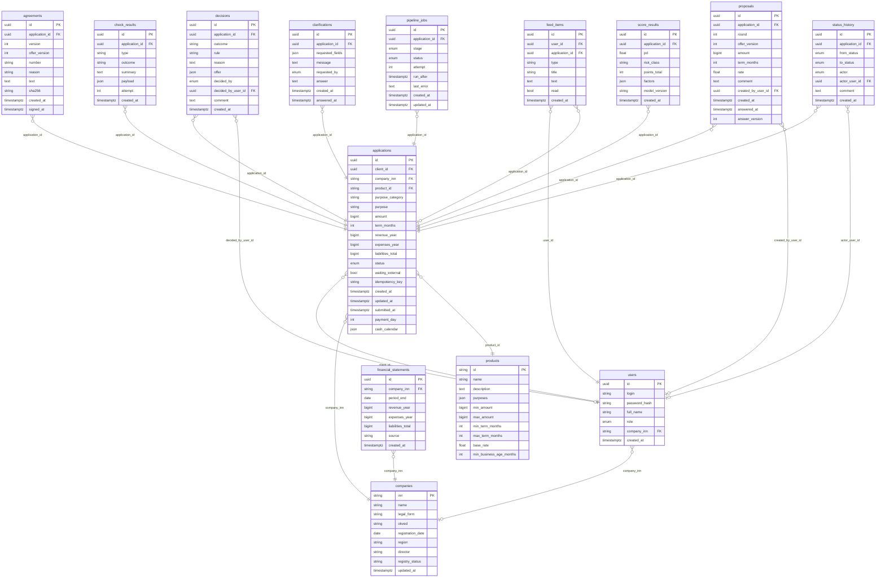

# Модель данных

<!-- Сгенерировано `make docs` (backend/app/docgen.py) из кода. Не править вручную. -->

PostgreSQL 16, схема создаётся миграциями Alembic (`backend/migrations`).
Перечисления хранятся строками со значениями из кода (`app/statuses.py`).

| Таблица | Назначение |
| --- | --- |
| `companies` | Компании клиентов: реквизиты из реестра (сид из `config/demo_companies.yaml`). |
| `products` | Кредитные продукты (сид из `config/products.yaml`). |
| `financial_statements` | Зарезервирована под историю отчётности; в текущей версии не заполняется. |
| `users` | Учётные записи клиентов и сотрудников банка; пароли хранятся в bcrypt. |
| `applications` | Заявка: продукт, сумма, срок, цель, финпоказатели клиента, статус, ключ идемпотентности. |
| `agreements` |  |
| `check_results` | Результаты проверок: полнота, ЕГРЮЛ/ЕГРИП, «Прозрачный бизнес», БКИ — с исходным ответом источника. |
| `clarifications` | Запросы уточнений (системы или сотрудника) и ответы клиента. |
| `decisions` | Решения системы и сотрудника: правило, объяснение для клиента, условия. |
| `feed_items` | Уведомления клиента о ходе заявки; создаются при переходах статуса. |
| `pipeline_jobs` | Очередь задач конвейера: этап, попытка, время следующего запуска (`SELECT … FOR UPDATE SKIP LOCKED`). |
| `proposals` |  |
| `score_results` | Оценка риска: PD, класс риска, баллы, факторы, версия модели. |
| `status_history` | Журнал переходов: откуда, куда, кто (клиент, система, сотрудник), комментарий. Это аудит заявки. |
