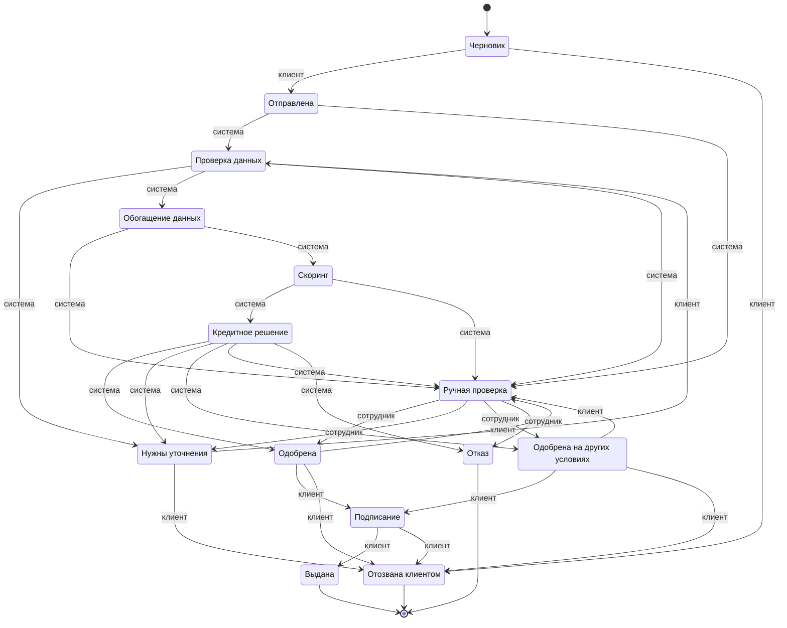

# Диаграмма состояний заявки

<!-- Сгенерировано `make docs` (backend/app/docgen.py) из кода. Не править вручную. -->

Источник — `backend/app/statuses.py`: таблица переходов `TRANSITIONS` и владелец хода
`TURN_OWNER`. Подпись на стрелке — кто переводит заявку из исходного статуса. Любой
переход проходит через `lifecycle.transition`: недопустимый переход или чужой ход
отклоняется (HTTP 409), каждый переход пишется в `status_history`.

| Статус | Подпись | Этап для клиента | Чей ход | Следующие статусы | Что видит клиент |
| --- | --- | --- | --- | --- | --- |
| `draft` | Черновик | Заполняете заявку | клиент | `submitted`, `withdrawn` | Заполните сумму, срок и цель и отправьте заявку. Черновик сохраняется сам. |
| `submitted` | Отправлена | Проверяем заявку | система | `data_check`, `manual_review` | Заявка принята. Мы проверим данные — от вас ничего не требуется. |
| `data_check` | Проверка данных | Проверяем заявку | система | `clarification_required`, `enrichment`, `manual_review` | Проверяем, что все данные заполнены. От вас ничего не требуется. |
| `clarification_required` | Нужны уточнения | Нужно ваше действие | клиент | `data_check`, `withdrawn` | Нам не хватает данных. Ответьте на вопрос ниже — после этого проверка продолжится. |
| `enrichment` | Обогащение данных | Проверяем заявку | система | `manual_review`, `scoring` | Сверяем данные о компании с государственными реестрами и кредитной историей. |
| `scoring` | Скоринг | Проверяем заявку | система | `credit_decision`, `manual_review` | Оцениваем финансовое положение компании. |
| `credit_decision` | Кредитное решение | Проверяем заявку | система | `approved`, `clarification_required`, `counter_offer`, `manual_review`, `rejected` | Готовим решение по заявке. |
| `manual_review` | Ручная проверка | Проверяем заявку | сотрудник | `approved`, `clarification_required`, `counter_offer`, `rejected` | Заявку смотрит кредитный специалист. Обычно это занимает до одного дня. |
| `approved` | Одобрена | Решение готово | клиент | `manual_review`, `signing`, `withdrawn` | Банк готов выдать кредит на запрошенных условиях. Примите их, предложите свои или откажитесь. |
| `counter_offer` | Одобрена на других условиях | Решение готово | клиент | `manual_review`, `signing`, `withdrawn` | Банк готов выдать кредит на других условиях. Примите их, предложите свои или откажитесь. |
| `rejected` | Отказ | Готово | — | — | К сожалению, банк не может выдать кредит. Причина указана ниже. |
| `signing` | Подписание | Оформление | клиент | `issued`, `withdrawn` | Подпишите документы, после этого деньги поступят на счёт. |
| `issued` | Выдана | Готово | — | — | Кредит выдан, деньги поступили на счёт компании. |
| `withdrawn` | Отозвана клиентом | Готово | — | — | Заявка отозвана. |
